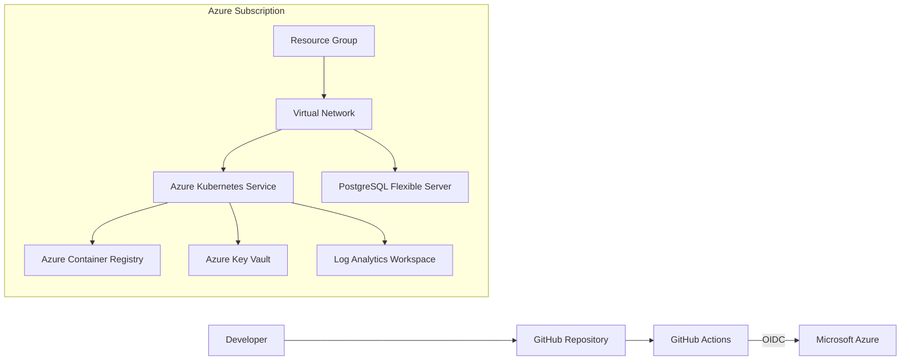

# Azure Enterprise Platform

Production-style Azure infrastructure lab built with Terraform, GitHub Actions and Azure OIDC.

> Portfolio project: designed to demonstrate enterprise Azure, networking, security, IaC and CI/CD skills. It uses generic demo values and contains no employer code, credentials or tenant-specific data.

## Architecture



## What this repository demonstrates

- Terraform modules and reusable infrastructure-as-code
- Separate `dev` and `prod` environments
- Azure Virtual Network and isolated subnets
- Azure Kubernetes Service with managed identity
- Azure Container Registry
- Azure Key Vault with RBAC authorization
- Azure Database for PostgreSQL Flexible Server
- Log Analytics monitoring
- GitHub Actions CI for formatting, validation and security scanning
- GitHub OIDC workflow for Azure authentication without long-lived secrets
- Naming, tagging and environment separation

## Repository layout

```text
.
├── .github/workflows/       # CI and Terraform plan workflows
├── docs/                    # Architecture and setup notes
├── envs/
│   ├── dev/                 # Development environment
│   └── prod/                # Production environment
├── modules/
│   ├── aks/
│   ├── keyvault/
│   ├── network/
│   ├── observability/
│   ├── postgresql/
│   └── registry/
├── scripts/
├── .gitignore
├── LICENSE
└── README.md
```

## Quick start

### 1. Prerequisites

- Terraform 1.8+
- Azure CLI
- An Azure subscription

### 2. Login locally

```bash
az login
az account set --subscription "<SUBSCRIPTION_ID>"
```

### 3. Configure the dev environment

```bash
cd envs/dev
cp terraform.tfvars.example terraform.tfvars
```

Edit `terraform.tfvars` and set your subscription ID and PostgreSQL administrator password.

### 4. Validate before deploying

```bash
terraform init
terraform fmt -check -recursive
terraform validate
terraform plan
```

### 5. Deploy

```bash
terraform apply
```

> Azure resources can create charges. Destroy lab resources when finished with `terraform destroy`.

## GitHub Actions + Azure OIDC

The repository includes an OIDC-based Terraform workflow. In GitHub repository settings, add these **Repository Variables**:

- `AZURE_CLIENT_ID`
- `AZURE_TENANT_ID`
- `AZURE_SUBSCRIPTION_ID`

No Azure client secret is required when workload identity federation is configured correctly.

See [`docs/github-oidc.md`](docs/github-oidc.md) for the Azure setup.

## Security choices

- No credentials committed to Git
- Key Vault uses Azure RBAC authorization
- PostgreSQL public access is disabled
- AKS uses managed identity
- Kubernetes local accounts are disabled
- Network Policy is enabled for AKS
- GitHub Actions has least-privilege workflow permissions
- Terraform files are scanned with Trivy in CI

## Portfolio talking points

This project can be used to discuss:

1. Why infrastructure is split into reusable Terraform modules.
2. How development and production remain isolated.
3. Why OIDC is safer than storing Azure client secrets in GitHub.
4. How private networking limits direct access to data services.
5. How managed identities reduce credential management.
6. How CI catches formatting, validation and security issues before deployment.

## Important

This is a portfolio/lab architecture, not a drop-in production baseline. A real production platform should additionally include organization-specific policies, budgets, private DNS, backup requirements, disaster recovery, SIEM integration, approval gates and platform governance.
