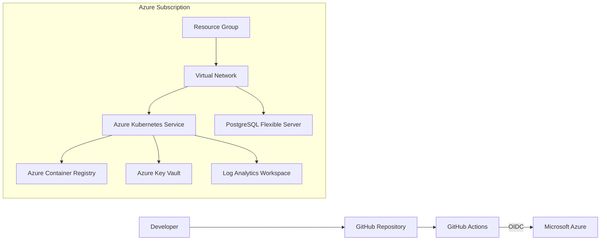

# Azure Enterprise Platform

[](https://github.com/ispartaliemir32/azure-enterprise-platform/actions/workflows/terraform-ci.yml)
[](https://github.com/ispartaliemir32/azure-enterprise-platform/actions/workflows/terraform-plan.yml)


Production-style Azure infrastructure lab built with **Terraform, GitHub Actions, Azure OIDC and Kubernetes**.

> Portfolio project designed to demonstrate enterprise Azure, networking, security, IaC and CI/CD skills. It uses generic demo values and contains no employer code, credentials or tenant-specific data.

## Architecture



## What this repository demonstrates

- Reusable Terraform modules and infrastructure-as-code practices
- Separate `dev` and `prod` environments
- Azure Virtual Network and isolated subnets
- Azure Kubernetes Service with managed identity
- Azure Container Registry
- Azure Key Vault with RBAC authorization
- Azure Database for PostgreSQL Flexible Server
- Log Analytics monitoring
- GitHub Actions CI for formatting, validation and security scanning
- GitHub OIDC for Azure authentication without long-lived client secrets
- Naming, tagging and environment separation

## Enterprise design choices

| Area | Design choice |
|---|---|
| Identity | Managed identities and GitHub OIDC |
| Secrets | Azure Key Vault instead of credentials in code |
| Network | Isolated subnets and restricted service access |
| Compute | AKS with managed identity and network policy |
| Data | PostgreSQL Flexible Server with public access disabled |
| Delivery | GitHub Actions for validation and Terraform plan |
| Environments | Isolated development and production configuration |
| Security | Trivy scanning and least-privilege workflow permissions |

## Repository layout

```text
.
├── .github/workflows/       # CI and Terraform plan workflows
├── docs/                    # Architecture and setup notes
├── envs/
│   ├── dev/                 # Development environment
│   └── prod/                # Production environment
├── modules/
│   ├── aks/
│   ├── keyvault/
│   ├── network/
│   ├── observability/
│   ├── postgresql/
│   └── registry/
├── scripts/
├── .gitignore
├── LICENSE
└── README.md
```

## Quick start

### Prerequisites

- Terraform 1.8+
- Azure CLI
- An Azure subscription

### Login locally

```bash
az login
az account set --subscription "<SUBSCRIPTION_ID>"
```

### Configure the development environment

```bash
cd envs/dev
cp terraform.tfvars.example terraform.tfvars
```

Edit `terraform.tfvars` and provide your own lab values. Never commit credentials or secrets.

### Validate before deploying

```bash
terraform init
terraform fmt -check -recursive
terraform validate
terraform plan
```

### Deploy

```bash
terraform apply
```

> Azure resources can create charges. Destroy lab resources when finished with `terraform destroy`.

## GitHub Actions + Azure OIDC

The repository includes an OIDC-based Terraform workflow. Configure these **Repository Variables** in GitHub:

- `AZURE_CLIENT_ID`
- `AZURE_TENANT_ID`
- `AZURE_SUBSCRIPTION_ID`

No Azure client secret is required when workload identity federation is configured correctly.

See [`docs/github-oidc.md`](docs/github-oidc.md) for setup details.

## Security choices

- No credentials committed to Git
- Key Vault uses Azure RBAC authorization
- PostgreSQL public access is disabled
- AKS uses managed identity
- Kubernetes local accounts are disabled
- Network Policy is enabled for AKS
- GitHub Actions uses least-privilege workflow permissions
- Terraform files are scanned with Trivy in CI

## Interview / portfolio talking points

This project is useful for discussing:

1. Why infrastructure is split into reusable Terraform modules.
2. How development and production remain isolated.
3. Why OIDC is safer than storing Azure client secrets in GitHub.
4. How private networking reduces direct exposure of data services.
5. How managed identities reduce credential management.
6. How CI catches formatting, validation and security issues before deployment.
7. How the same design can evolve toward GitOps and policy-as-code.

## Documentation

- [Architecture](docs/architecture.md)
- [GitHub OIDC setup](docs/github-oidc.md)

## Related projects

- [Cloud Security Lab](https://github.com/ispartaliemir32/cloud-security-lab): Sentinel and KQL detections for Entra ID and Azure Activity, including RBAC and resource-group monitoring
- [Entra & Intune Automation](https://github.com/ispartaliemir32/entra-intune-automation): read-only identity and device reporting with PowerShell and Microsoft Graph

## Important

This is a portfolio/lab architecture, not a drop-in production baseline. A real production platform should additionally include organization-specific policies, budgets, private DNS, backup requirements, disaster recovery, SIEM integration, approval gates and platform governance.
