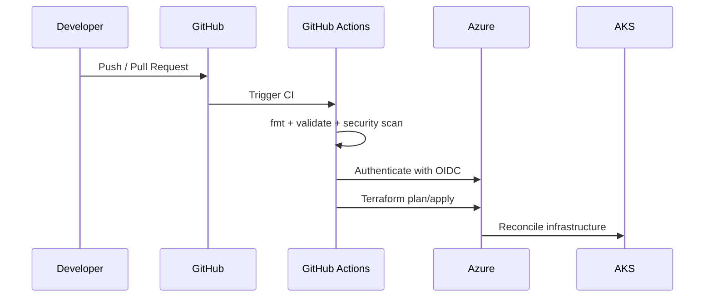

# Architecture

The platform is intentionally separated into reusable Terraform modules. The environment layer composes the modules and supplies environment-specific settings.

## Main components

| Component | Purpose |
|---|---|
| Resource Group | Lifecycle and ownership boundary |
| Virtual Network | Private network boundary |
| AKS subnet | Kubernetes worker nodes |
| Data subnet | Delegated subnet for PostgreSQL |
| AKS | Container orchestration |
| ACR | Private container registry |
| Key Vault | Secret and key management |
| PostgreSQL | Managed relational database |
| Log Analytics | Central Azure monitoring workspace |

## Request / deployment flow

## Environment model

`dev` is intentionally smaller and cheaper. `prod` demonstrates a more resilient configuration with multiple AKS nodes and stronger database sizing.
